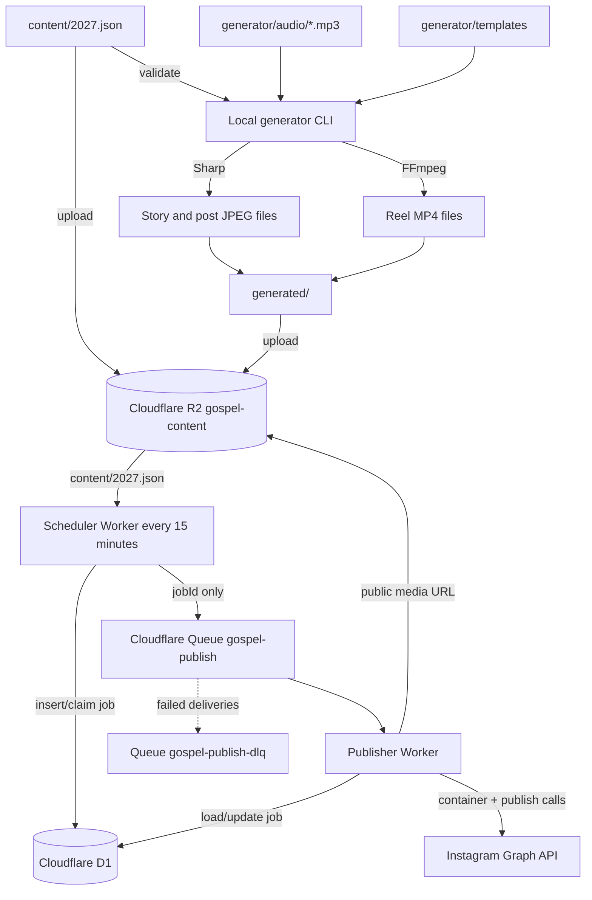

# Deployment Runbook

This document takes Gospel of Jesus Automation from a local checkout to a safely tested production deployment. Complete the sections in order. Keep `DRY_RUN=true` until the production readiness checklist explicitly tells you to change it.

## 1. Understand how the modules connect



The generator runs on your computer or GitHub Actions. Cloudflare Workers never run Sharp or FFmpeg. The scheduler reads the yearly JSON from R2, converts its local publishing time to UTC, creates one unique D1 job for each date and content type, and sends only the D1 job ID to the queue. The publisher retrieves that row, gives Instagram the public R2 media URL, records the Instagram container and media IDs, and marks the job published.

The important module connections are:

| Source           | Destination      | Connection                                                       |
| ---------------- | ---------------- | ---------------------------------------------------------------- |
| Local generator  | R2               | S3-compatible credentials in local environment or GitHub Secrets |
| Scheduler Worker | R2               | `CONTENT` binding                                                |
| Scheduler Worker | D1               | `DB` binding                                                     |
| Scheduler Worker | Queue            | `PUBLISH_QUEUE` producer binding                                 |
| Queue            | Publisher Worker | `gospel-publish` consumer configuration                          |
| Publisher Worker | D1               | `DB` binding to the same database                                |
| Publisher Worker | Queue            | `PUBLISH_QUEUE` producer binding for manual retries              |
| Publisher Worker | Instagram        | Worker secrets and HTTPS Graph API calls                         |
| Instagram        | R2               | Public HTTPS URL under `PUBLIC_R2_BASE_URL`                      |

Both Workers must use the same D1 database. Both queue bindings must use the exact queue name `gospel-publish`. The scheduler R2 binding must point to the bucket receiving uploads.

## 2. Prepare the local machine

Install:

- Node.js 22 or newer
- npm
- FFmpeg with `libx264` and AAC support
- Git

Check them:

```bash
node --version
npm --version
ffmpeg -version
ffmpeg -hide_banner -encoders | grep -E 'libx264|aac'
```

From the repository root:

```bash
npm ci
npm run build
npm run lint
npm test
npm run format:check
```

Do not continue until all four project checks pass.

## 3. Prepare content and audio

Create the complete yearly file at `content/YYYY.json`. The top-level `year` must match the filename, and every date must belong to that year. Scripture is published exactly as written; proofread it before rendering.

Add properly licensed MP3 files under `generator/audio/` using these exact names:

```text
peaceful_01.mp3
peaceful_02.mp3
peaceful_03.mp3
hopeful_01.mp3
prayer_01.mp3
night_01.mp3
```

Keep the license receipt or source record outside the public repository. Validate before generating:

```bash
npm run validate -- --year 2027
```

Preview one item of every type:

```bash
npm run generate:story -- --date 2027-01-01
npm run generate:post -- --date 2027-01-01
npm run generate:reel -- --date 2027-01-01
```

Open the resulting files under `generated/`. Check spelling, text wrapping, safe margins, Reel playback, audio volume, and duration. Then generate the required range or full year:

```bash
npm run generate:range -- --from 2027-01-01 --to 2027-01-31
# or
npm run generate:year -- --year 2027
```

## 4. Authenticate Wrangler

Log in to the Cloudflare account that owns the domain you will use for R2:

```bash
npx wrangler login
npx wrangler whoami
```

Use one Cloudflare account for the Workers, D1 database, R2 bucket, and queues. This avoids binding and account-ID mistakes.

## 5. Create the Cloudflare resources

From the repository root, create the database, storage bucket, main queue, and dead-letter queue:

```bash
npx wrangler d1 create gospel-instagram
npx wrangler r2 bucket create gospel-content
npx wrangler queues create gospel-publish
npx wrangler queues create gospel-publish-dlq
```

The D1 command prints a database UUID. Replace `REPLACE_ME` with that UUID in both files:

- `apps/scheduler-worker/wrangler.jsonc`
- `apps/publisher-worker/wrangler.jsonc`

Confirm that both configurations contain the same `database_id`. Do not change binding names such as `DB`, `CONTENT`, or `PUBLISH_QUEUE` unless you also update the TypeScript environment interfaces and code.

Apply the migration:

```bash
npx wrangler d1 migrations apply gospel-instagram \
  --remote \
  --config apps/scheduler-worker/wrangler.jsonc
```

Confirm the table exists:

```bash
npx wrangler d1 execute gospel-instagram \
  --remote \
  --config apps/scheduler-worker/wrangler.jsonc \
  --command "SELECT name FROM sqlite_master WHERE type='table';"
```

You should see `publishing_jobs` and Cloudflare's migration table.

## 6. Make R2 media publicly reachable

Instagram fetches media from a URL. The R2 bucket is private by default, so connect a production custom domain such as `media.yourdomain.com` in Cloudflare Dashboard:

1. Open **R2 Object Storage**.
2. Select `gospel-content`.
3. Open **Settings**.
4. Under **Custom Domains**, select **Add**.
5. Connect `media.yourdomain.com` and wait until its status is active.

Use the custom domain as:

```text
PUBLIC_R2_BASE_URL=https://media.yourdomain.com
```

Do not put a trailing slash in this value. Do not use an authenticated URL, Cloudflare Access login, expiring signed URL, hotlink block, or bot challenge on media paths; Meta's servers must fetch them without interaction. Cloudflare documents custom domains as the production path, while `r2.dev` is intended for non-production use.

## 7. Create narrowly scoped R2 upload credentials

In Cloudflare Dashboard:

1. Open **R2 Object Storage** → **Manage API Tokens**.
2. Create an R2 token with **Object Read & Write**.
3. Restrict it to the `gospel-content` bucket.
4. Copy the Access Key ID and Secret Access Key immediately.
5. Record the Cloudflare Account ID.

Set them only in your current shell or an ignored local environment file:

```bash
export R2_ACCOUNT_ID="your-cloudflare-account-id"
export R2_ACCESS_KEY_ID="your-r2-access-key-id"
export R2_SECRET_ACCESS_KEY="your-r2-secret-access-key"
export R2_BUCKET="gospel-content"
```

Upload the media and yearly JSON:

```bash
npm run upload -- --year 2027
```

Verify at least one object of each enabled type and the JSON:

```bash
curl -I https://media.yourdomain.com/content/2027.json
curl -I https://media.yourdomain.com/stories/2027/01/2027-01-01.jpg
curl -I https://media.yourdomain.com/posts/2027/01/2027-01-01.jpg
curl -I https://media.yourdomain.com/reels/2027/01/2027-01-01.mp4
```

Expect HTTP 200 and appropriate `content-type` headers.

## 8. Configure Meta and Instagram

The current publisher uses `graph.facebook.com`, so configure the **Instagram API with Facebook Login** flow:

1. Convert or use an Instagram **professional account**.
2. Link it to a Facebook Page that you administer.
3. Create a Meta developer app using a business-capable app type.
4. Add the Instagram Graph API product and Facebook Login as required by Meta's current setup flow.
5. Add your Facebook user as an app administrator/developer while testing.
6. Grant the current permissions required by Meta's Facebook Login content-publishing guide. These commonly include Instagram basic/content publishing and Page discovery/read permissions; use the exact current names shown by Meta for your app and API version.
7. Obtain the Instagram professional account ID, not the Instagram username and not the Facebook Page ID.
8. Generate a long-lived access token suitable for the account.
9. Complete App Review and business verification before publishing for users or accounts that do not have an app role.

The implemented request sequence is:

```text
POST /{instagram-account-id}/media
GET  /{container-id}?fields=status_code
POST /{instagram-account-id}/media_publish
```

Feed and Story images use `image_url`; Stories add `media_type=STORIES`. Reels use `video_url` with `media_type=REELS`. Before production, compare this flow and the configured API version with Meta's current official content-publishing documentation. Meta permissions, version lifetimes, account eligibility, and Story support can change.

Test the token manually without printing it into shared logs or shell history. A safe option is Meta's Graph API Explorer or a private terminal session. Confirm that you can resolve the intended Instagram professional account ID and that the token has the required publishing permissions.

## 9. Configure Worker variables and secrets

In `apps/publisher-worker/wrangler.jsonc`, set:

```jsonc
"vars": {
  "INSTAGRAM_API_VERSION": "the-current-supported-version",
  "PUBLIC_R2_BASE_URL": "https://media.yourdomain.com",
  "DRY_RUN": "true",
  "MAX_ATTEMPTS": "5",
  "TIMEZONE": "Asia/Kolkata"
}
```

In `apps/scheduler-worker/wrangler.jsonc`, set:

```jsonc
"vars": {
  "TIMEZONE": "Asia/Kolkata",
  "GRACE_WINDOW_MINUTES": "30",
  "DRY_RUN": "true"
}
```

Create a high-entropy admin key, for example with a password manager. Store the three sensitive values as Worker secrets using the publisher configuration explicitly:

```bash
npx wrangler secret put INSTAGRAM_ACCESS_TOKEN \
  --config apps/publisher-worker/wrangler.jsonc
npx wrangler secret put INSTAGRAM_ACCOUNT_ID \
  --config apps/publisher-worker/wrangler.jsonc
npx wrangler secret put ADMIN_API_KEY \
  --config apps/publisher-worker/wrangler.jsonc
```

Wrangler may create a Worker version when setting secrets. That is expected. Never add these values to `wrangler.jsonc`, `.env.example`, source code, a committed `.env`, an issue, or a chat message.

## 10. Build and deploy in dry-run mode

Validate both Worker bundles before deployment:

```bash
npx wrangler deploy --dry-run --config apps/scheduler-worker/wrangler.jsonc
npx wrangler deploy --dry-run --config apps/publisher-worker/wrangler.jsonc
```

Deploy the publisher first so a consumer exists before the scheduler starts producing jobs:

```bash
npx wrangler deploy --config apps/publisher-worker/wrangler.jsonc
npx wrangler deploy --config apps/scheduler-worker/wrangler.jsonc
```

The scheduler Cron Trigger is declared as `*/15 * * * *`. Cloudflare cron expressions run in UTC; application code reads the configured timezone, automatically selects `content/YYYY.json`, and performs the conversion. Do not convert the JSON times to UTC yourself.

Find the publisher Worker URL in the Wrangler output or Cloudflare Dashboard and test:

```bash
curl https://YOUR-PUBLISHER-WORKER.workers.dev/health
```

Expected response:

```json
{ "status": "ok", "service": "gospel-instagram-publisher", "dryRun": true }
```

Tail both Workers during the first dry run in separate terminals:

```bash
npx wrangler tail gospel-instagram-scheduler
npx wrangler tail gospel-instagram-publisher
```

## 11. Perform an end-to-end dry run

Use a test entry scheduled 5–15 minutes in the future in `content/2027.json`. Keep its timezone correct. Then:

1. Validate the file.
2. Generate its media.
3. Upload the year so both JSON and media are current in R2.
4. Wait for the next 15-minute cron boundary.
5. Watch scheduler and publisher logs.
6. Query the protected endpoint.

```bash
curl -H "Authorization: Bearer YOUR_ADMIN_API_KEY" \
  https://YOUR-PUBLISHER-WORKER.workers.dev/api/jobs/today
```

The row should move to `published` with IDs beginning `dry-container-` and `dry-media-`. No Instagram request is made in dry-run mode.

If no row appears, verify the automatically selected R2 `content/YYYY.json` path, the JSON timezone/date, the grace window, cron deployment, and scheduler logs. If a row remains failed, inspect `/api/jobs/failed` and the publisher logs.

## 12. Production cutover

Before changing dry-run mode, confirm every item:

- The yearly JSON validates.
- All enabled media files were visually reviewed and uploaded.
- Each media URL returns HTTP 200 publicly.
- The D1 migration is applied.
- Both Worker configurations reference the same D1 database.
- Queue names match exactly and `gospel-publish` has only the publisher Worker as consumer.
- Meta app, professional account, Page link, permissions, token, and app review are ready.
- The Instagram account ID is correct.
- The access token has an expiry/rotation reminder.
- Dry-run completed end to end.
- There are no unexpected pending, queued, failed, or permanently failed jobs.

Set `DRY_RUN` to `"false"` in both Wrangler files, review the diff, and redeploy publisher first and scheduler second:

```bash
npx wrangler deploy --config apps/publisher-worker/wrangler.jsonc
npx wrangler deploy --config apps/scheduler-worker/wrangler.jsonc
```

Schedule one low-risk production item and monitor it. Confirm the post appears on Instagram and the D1 row contains `status=published` and an `instagram_media_id`.

## 13. Configure GitHub Actions if desired

The `Generate Media` workflow is manual only. Add these repository or environment secrets:

```text
R2_ACCOUNT_ID
R2_ACCESS_KEY_ID
R2_SECRET_ACCESS_KEY
R2_BUCKET
```

The workflow downloads licensed MP3 files from the bucket's `source-audio/` prefix before validation. Upload those source files once with the S3-compatible API, and use an R2 rule or separate private source bucket if your public custom domain exposes every object. Never make licensed source tracks publicly browsable merely to supply CI. The generated Reel contains the mixed audio; the source MP3 does not need public access.

Example initial upload with the AWS CLI and the same scoped credentials:

```bash
aws s3 cp generator/audio/ s3://gospel-content/source-audio/ \
  --recursive \
  --exclude "README.md" \
  --endpoint-url "https://${R2_ACCOUNT_ID}.r2.cloudflarestorage.com"
```

Use a protected GitHub Environment for production R2 credentials and require review before the upload job if more than one person maintains the repository. Run **Actions → Generate Media → Run workflow**, enter the year, and inspect every step.

## 14. Normal operating procedure

For a content correction:

```bash
npm run validate -- --year 2027
npm run generate:date -- --date 2027-05-15
npm run upload -- --year 2027
```

The upload command currently uploads all generated files for that year plus the JSON. Paths are deterministic and overwrite matching R2 objects.

For status checks:

```bash
curl -H "Authorization: Bearer YOUR_ADMIN_API_KEY" \
  https://YOUR-PUBLISHER-WORKER.workers.dev/api/jobs/failed
```

Retry only after fixing the cause:

```bash
curl -X POST \
  -H "Authorization: Bearer YOUR_ADMIN_API_KEY" \
  https://YOUR-PUBLISHER-WORKER.workers.dev/api/jobs/JOB_ID/retry
```

If a publish request timed out after reaching Instagram, first inspect the Instagram account and D1 row. A remote publish may have succeeded even if the Worker did not receive the response. Do not manually retry until you rule out an already-published item.

Rotate the Instagram token before expiry. Update it with `wrangler secret put`, verify `/health`, and monitor the next scheduled publication. Rotate the admin key and R2 credentials immediately if they may have been exposed.

## 15. What you should not do

- Do not put access tokens, account IDs intended as secrets, admin keys, or R2 secret keys in Git.
- Do not paste secrets into logs, screenshots, issue trackers, pull requests, or support chats.
- Do not set Instagram or admin credentials under Wrangler `vars`; use Worker secrets.
- Do not use a personal Instagram account. Use a supported professional account.
- Do not use Instagram username/password automation, Selenium, Playwright, scraping, or unofficial APIs.
- Do not add AI generation or scripture paraphrasing at runtime. JSON is the source of truth.
- Do not use copyrighted Instagram-library music. Use only locally licensed royalty-free audio.
- Do not run FFmpeg or Sharp inside Cloudflare Workers.
- Do not expose the admin endpoints without a strong `ADMIN_API_KEY` or a compatible Cloudflare Access policy.
- Do not protect public R2 media URLs with login, cookies, expiring signatures, or interactive challenges.
- Do not change queue or binding names in only one configuration file.
- Do not attach a second consumer Worker to `gospel-publish`; Cloudflare Queues permits one consumer per queue.
- Do not hard-code an India UTC offset or manually shift content times. Keep `timezone` as an IANA name such as `Asia/Kolkata`.
- Do not edit generated images or videos and forget to upload them again.
- Do not upload updated media after its job has already published and expect Instagram to update the existing post.
- Do not delete or modify published D1 rows to force a retry. Use the protected retry endpoint only for failed jobs.
- Do not retry an ambiguous timeout without checking Instagram first.
- Do not set an excessive grace window; old content could publish much later than intended.
- Do not turn off `DRY_RUN` until the complete dry-run checklist passes.
- Do not use `npm audit fix --force` blindly; review breaking dependency upgrades and rerun all checks.
- Do not deploy from an unreviewed content file or while validation/tests are failing.

## 16. Backup and recovery

Keep the authored JSON, templates, schema, migrations, and source in Git. Generated media can be recreated, but retain licensed source audio and its license records in secure backup storage.

D1's unique `(content_date, content_type)` constraint is part of publication safety. Never remove it. Before manual database repair, export or back up D1 and record the reason for the change.

If the publisher must be stopped urgently, disable the scheduler Cron Trigger or redeploy both Workers with `DRY_RUN=true`. Pausing scheduling is safer than deleting D1 rows or queues. Inspect queued and failed jobs before resuming.

## 17. Official references

- [Meta: Instagram API with Facebook Login](https://developers.facebook.com/docs/instagram-platform/instagram-api-with-facebook-login/)
- [Meta: Content publishing](https://developers.facebook.com/docs/instagram-platform/instagram-api-with-facebook-login/content-publishing/)
- [Cloudflare: Cron Triggers](https://developers.cloudflare.com/workers/configuration/cron-triggers/)
- [Cloudflare: Queues getting started](https://developers.cloudflare.com/queues/get-started/)
- [Cloudflare: D1 migrations](https://developers.cloudflare.com/d1/reference/migrations/)
- [Cloudflare: Public R2 buckets and custom domains](https://developers.cloudflare.com/r2/buckets/public-buckets/)
- [Cloudflare: R2 S3 credentials](https://developers.cloudflare.com/r2/get-started/s3/)
- [Cloudflare: Worker secrets](https://developers.cloudflare.com/workers/configuration/secrets/)
