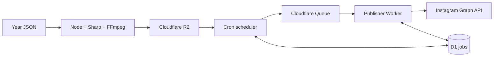

# Gospel of Jesus Automation

A low-maintenance TypeScript system that renders pre-authored yearly Bible content locally and publishes it through Instagram's official API. It performs no AI generation and never changes verse wording. The JSON file is the sole editorial source.



## Prerequisites and installation

Use Node.js 22 or newer, npm, FFmpeg with H.264/AAC encoders, a Cloudflare account, and a Meta app attached to an Instagram professional account.

```bash
npm install
ffmpeg -version
cp .env.example .env
```

The local `generator/audio/` library contains 20 free instrumental tracks by Kevin MacLeod under CC BY 4.0. Source metadata and license records are in `generator/audio/licenses/`; MP3s stay local and are ignored by Git. All enabled reels in 2026 and 2027 rotate through the library, and the scheduler adds the selected track's attribution to its Reel caption. Run `npm run audio:rotate` to reassign the rotation after editing the calendar. This changes only enabled Reel audio choices. Validation checks every enabled Reel's audio file.

## Content and local generation

`content/schema.json` is the machine-readable contract. `content/2026.json` covers September 15 through December 31, and `content/2027.json` covers the full year. The included scripture quotations use the public-domain King James Version (KJV). Times are IANA-local wall times. Luxon converts them using timezone rules, including DST where applicable.

```bash
npm run validate -- --year 2027
npm run generate:date -- --date 2027-01-01
npm run generate:range -- --from 2027-05-01 --to 2027-05-31
npm run generate:year -- --year 2027
npm run generate:story -- --date 2027-01-01
npm run generate:post -- --date 2027-01-01
npm run generate:reel -- --date 2027-01-01
```

Images are Instagram-compatible JPEG files at 1080×1920 or 1080×1350. Reels are 1080×1920, 30 FPS H.264/AAC MP4 with normalized, faded audio. Outputs use deterministic paths under `generated/`; rerunning a date replaces those files.

## Cloudflare setup

Create the resources, then replace both `REPLACE_ME` D1 IDs in the Wrangler files:

```bash
npx wrangler d1 create gospel-instagram
npx wrangler d1 migrations apply gospel-instagram --remote --config apps/scheduler-worker/wrangler.jsonc
npx wrangler r2 bucket create gospel-content
npx wrangler queues create gospel-publish
npx wrangler queues create gospel-publish-dlq
```

Configure a public R2 custom domain. Instagram must be able to fetch each URL without cookies or authentication. Create an R2 API token for local/GitHub uploads and set `R2_ACCOUNT_ID`, `R2_ACCESS_KEY_ID`, `R2_SECRET_ACCESS_KEY`, and `R2_BUCKET`, then run:

```bash
npm run upload -- --year 2027
```

Store production secrets. Do not place them in Wrangler configuration:

```bash
cd apps/publisher-worker
npx wrangler secret put INSTAGRAM_ACCESS_TOKEN
npx wrangler secret put INSTAGRAM_ACCOUNT_ID
npx wrangler secret put ADMIN_API_KEY
```

Set `PUBLIC_R2_BASE_URL`, `INSTAGRAM_API_VERSION`, `MAX_ATTEMPTS`, `TIMEZONE`, and `DRY_RUN` in publisher `wrangler.jsonc`. Set `TIMEZONE`, `GRACE_WINDOW_MINUTES`, and `DRY_RUN` in scheduler configuration. The scheduler automatically selects `content/YYYY.json` from the local calendar year. Start with `DRY_RUN=true` and deploy:

```bash
npx wrangler deploy --config apps/publisher-worker/wrangler.jsonc
npx wrangler deploy --config apps/scheduler-worker/wrangler.jsonc
```

The scheduler's one `*/15 * * * *` UTC trigger loads the current local date from R2. A grace window prevents old content from unexpectedly publishing. D1's unique `(content_date, content_type)` constraint and conditional state transitions prevent duplicate scheduling and concurrent consumption. The stored container ID is designed for retry reuse. As with any remote API lacking a caller-supplied idempotency key, an upstream success followed by a lost HTTP response is inherently ambiguous; inspect the Instagram account before manually retrying that rare case.

## Instagram / Meta setup

Create a Meta app, add the Instagram API product, connect an Instagram professional account, and grant the app user/content publishing permissions required by the current Instagram API flow. Generate a long-lived production access token and use the professional Instagram account ID. The implementation creates `/media` containers using `image_url`, `media_type=REELS`, or `media_type=STORIES`, polls `status_code`, then calls `/media_publish`. Confirm the current supported API version and permissions before moving from dry-run because Meta versions and review requirements change.

The token is supplied through a `TokenProvider`, so a future refresh/rotation service can replace the environment-backed provider without changing publishing logic. Tokens and authorization headers are never logged.

## Operations, dry-run, and security

`GET /health` is public and contains no secrets. Send `Authorization: Bearer <ADMIN_API_KEY>` to these protected endpoints:

```text
GET  /api/jobs/today
GET  /api/jobs/failed
GET  /api/jobs/:id
POST /api/jobs/:id/retry
```

With `DRY_RUN=true`, scheduling and D1 transitions run normally while publishing records deterministic simulated Instagram IDs and makes no Instagram request. Structured JSON logs include job/date/type/operation/status and sanitized errors.

Queue attempts use controlled exponential delays. HTTP 429, 5xx, and network failures retry up to `MAX_ATTEMPTS`; malformed and other 4xx requests become permanently failed. A dead-letter queue is the final operational backstop.

## Testing and troubleshooting

```bash
npm run build
npm run lint
npm test
npm run format:check
```

If validation reports missing audio, add the licensed file named in the error. If FFmpeg fails, verify `libx264` and AAC are available with `ffmpeg -encoders`. For container failures, verify the R2 object is publicly reachable with the correct MIME type and inspect `last_error` through the admin endpoint. For 401/403 responses, rotate the token and confirm account permissions. Cron configuration can take several minutes to propagate.

The optional `Generate Media` GitHub Actions workflow runs only by manual dispatch. Add the four R2 values as GitHub Secrets and provide licensed audio to the runner through your own private artifact or repository policy before enabling Reel generation.
# gospel
